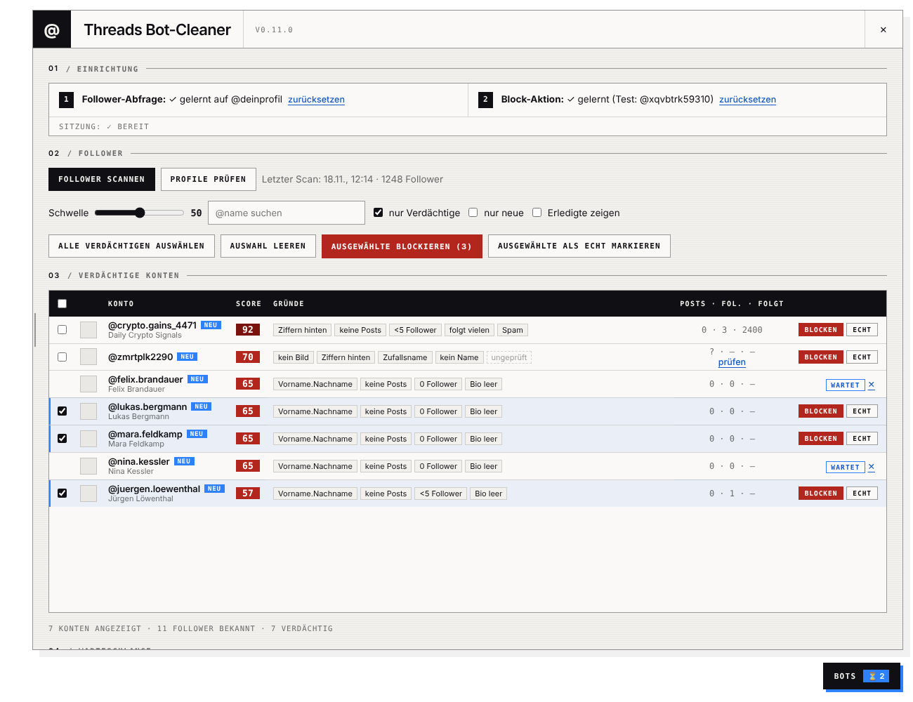
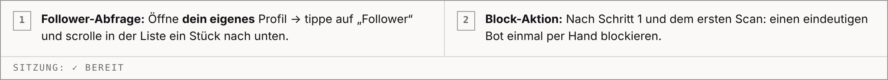
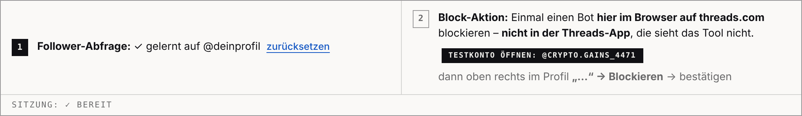
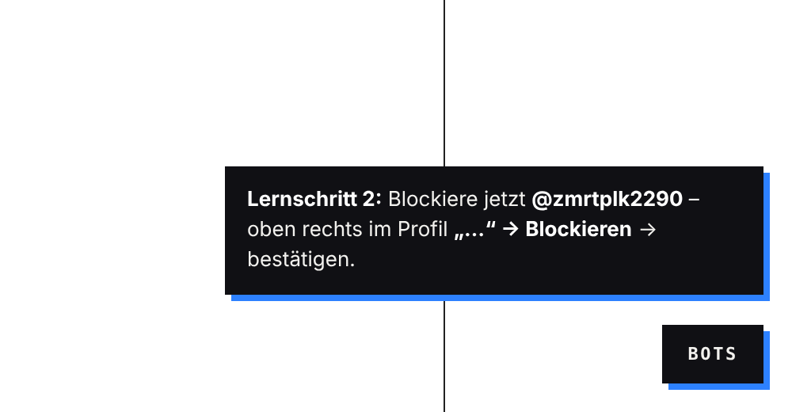
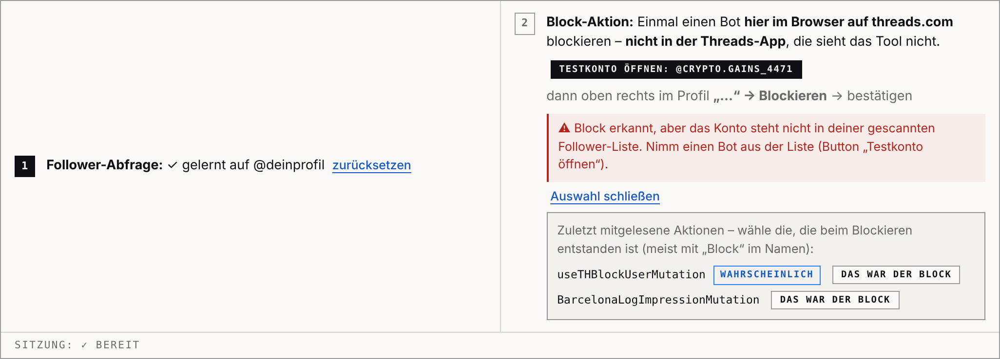
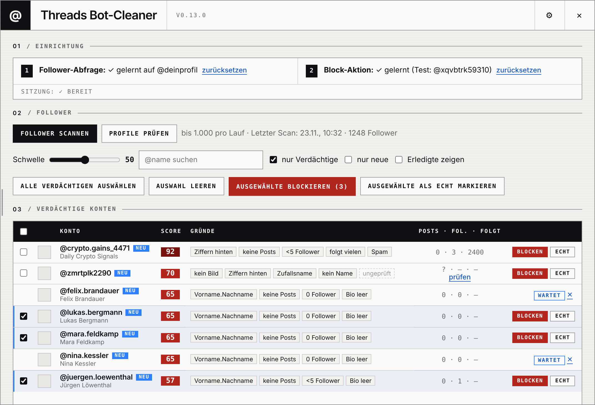
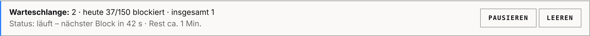
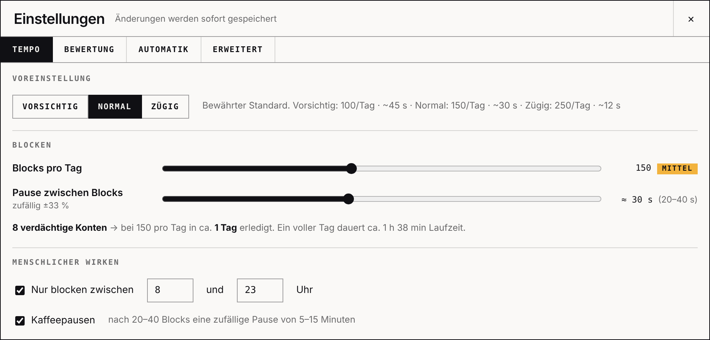
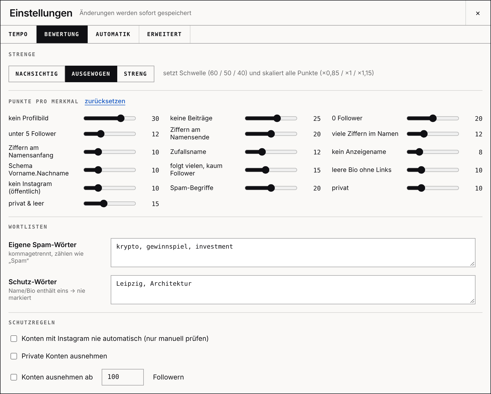

# Threads Bot-Cleaner

**Deutsch** · [English](#english)

Tampermonkey-Userscript, das Bot-Follower auf [Threads](https://www.threads.com) findet, bewertet und – nach deiner Auswahl – gedrosselt blockiert. Läuft komplett lokal in deinem Browser.

## Funktionen

- **Follower scannen** – lädt deine Follower in Blöcken (zuerst die neuesten 1000)
- **Profile prüfen** – Beiträge, Follower, Bio, Links, verknüpftes Instagram; daraus ein **Bot-Score 0–100** mit nachvollziehbaren Gründen
- **Blocken per Klick oder Bulk** – Zeilen anklicken, **Shift + Klick** für ganze Bereiche
- **Gedrosselte Warteschlange** – zufällige Pausen, Tageslimit, **Ruhezeiten** und **Kaffeepausen**, automatischer Stopp, wenn Meta bremst
- **Einstellungen (⚙)** – Tempo-Voreinstellungen, Gewichtung pro Merkmal, eigene Spam- und Schutz-Wörter, Schutzregeln
- **Autopilot & täglicher Check** – optional, eindeutige Bots automatisch einreihen
- **Läuft lokal** – kein Server, keine Drittanbieter, keine gespeicherten Tokens

> [!WARNING]
> **Inoffizielles Tool, nicht mit Meta verbunden.** Es automatisiert Aktionen in deinem eigenen, eingeloggten Browser und verstößt damit streng genommen gegen Metas Nutzungsbedingungen. Zu viele Blocks in kurzer Zeit können zu vorübergehenden Aktionssperren führen. **Nutzung auf eigenes Risiko.**

## Installation

1. **[Tampermonkey](https://www.tampermonkey.net/) installieren.**
   In Chrome/Edge zusätzlich: Erweiterungen → Tampermonkey → Details → **„Nutzerskripts zulassen“** einschalten (bei älteren Versionen: Entwicklermodus aktivieren).
2. **Script installieren:** 
   Ein Klick öffnet direkt den Installationsdialog von Tampermonkey – nichts herunterladen oder kopieren. *(Zeigt der Browser nur Text, ist Tampermonkey noch nicht installiert oder aktiv.)*
3. **threads.com neu laden** → unten rechts erscheint der Button **BOTS**.

Updates kommen automatisch über Tampermonkey (sofort: Dashboard → „Nach Updates suchen“).

## Erster Durchlauf – Schritt für Schritt

> [!IMPORTANT]
> Alles passiert **am Computer im Browser auf threads.com** – dort, wo Tampermonkey läuft. Was du in der **Threads-App auf dem Handy** machst, sieht das Tool nicht.

### 1. Follower-Abfrage lernen

Klicke unten rechts auf **BOTS**. Oben im Panel stehen die zwei Lernschritte. Öffne jetzt **dein eigenes** Profil, tippe auf **„Follower“** und scrolle in der Liste ein Stück nach unten. Schritt 1 wird dann schwarz mit ✓.

### 2. Follower scannen

Klicke auf **„Follower scannen“**. Das Tool lädt deine neuesten Follower (Standard: 1.000 pro Lauf) und prüft danach automatisch ihre Profile. Weitere lädst du mit **„Nächste … laden“**.

### 3. Block-Aktion lernen

Jetzt muss das Tool **einmal sehen, wie du blockierst**. Klicke bei Schritt 2 auf **„Testkonto öffnen“** – das öffnet einen eindeutigen Bot aus deiner Liste direkt im Browser.

Auf dem Profil erinnert dich ein Hinweis unten rechts, was zu tun ist: **oben rechts im Profil „…“ → Blockieren → bestätigen.** Danach meldet das Tool „✓ Block-Aktion gelernt“.

<b>Schritt 2 bleibt offen?</b> So geht's trotzdem

Wenn der Block erkannt, aber nicht gelernt wurde, steht der **Grund direkt bei Schritt 2** (rot). Darunter erscheint **„Block nicht erkannt? Anfrage auswählen“**: Dort siehst du die zuletzt mitgelesenen Aktionen. Wähle die mit **„Block“** im Namen (markiert als *wahrscheinlich*) und klicke **„Das war der Block“**.

Häufige Ursachen:
- In der **Handy-App** statt im Browser geblockt → im Browser wiederholen.
- Ein Konto geblockt, das **nicht in der gescannten Liste** steht → „Testkonto öffnen“ nutzen.
- Hilft nichts: Panel → Diagnose → „Diagnose-Info kopieren“ und als [Issue](https://github.com/DieDaddelecke/threads-bot-cleaner/issues/new/choose) melden.

### 4. Aufräumen

Beide Schritte haben jetzt ein ✓. Klicke Zeilen in der Liste an (**Shift + Klick** wählt einen ganzen Bereich) und dann **„Ausgewählte blockieren“** – oder einzelne Konten direkt mit **„Blocken“**. Echte Konten markierst du mit **„Echt“**, dann tauchen sie nie wieder auf.

Die **Warteschlange** blockt dann gedrosselt im Hintergrund – mit Pausen, Tageslimit, Ruhezeiten und Kaffeepausen. Sie läuft, solange ein Threads-Tab offen ist.

> [!TIP]
> **Beim ersten Mal klein anfangen:** erst 5–10 Konten blockieren und im Protokoll prüfen, ob alles klappt. Werte im gelben Bereich (knapp unter der Schwelle) vor dem Blocken kurz ansehen.

### Einstellungen

Über das **⚙-Symbol** oben im Panel, aufgeteilt in vier Reiter:

| Reiter | Was du einstellst |
|---|---|
| **Tempo** | Voreinstellung *Vorsichtig* (100/Tag, ~45 s) · *Normal* (150/Tag, ~30 s, Standard) · *Zügig* (250/Tag, ~12 s); Regler für Blocks pro Tag (75–250) mit Risiko-Ampel und Dauer-Anzeige; Pause zwischen Blocks (8–60 s, zufällig ±33 %); aktive Uhrzeiten (Standard 8–23 Uhr); Kaffeepausen (nach 20–40 Blocks 5–15 Min.) |
| **Bewertung** | Strenge *Nachsichtig / Ausgewogen / Streng*; Punkte pro Merkmal (0 = ignorieren); eigene Spam-Wörter; Schutz-Wörter (Name/Bio enthält eins → nie markiert); Schutzregeln für Konten mit Instagram, private Konten oder ab X Followern |
| **Automatik** | Autopilot: Konten ab Score X (Standard 85) automatisch einreihen – standardmäßig aus; täglicher Check der neuesten Follower beim Öffnen von Threads |
| **Erweitert** | Profil-Prüfung (parallel, Pause, Menge), Follower pro Scan |

 

Wenn Meta bremst, pausiert das Script automatisch 24 h. Die Warteschlange läuft, solange ein Threads-Tab offen ist, und setzt nach dem Neuladen fort.

## Bot-Score (0–100)

| Merkmal | Punkte |
|---|---|
| kein Profilbild | +30 |
| keine Beiträge | +25 |
| Ziffernfolge am Ende / am Anfang des Namens | +20 / +10 |
| 0 Follower / weniger als 5 | +20 / +12 |
| Spam-Begriffe (Crypto, Forex, „DM me“ …) | +20 |
| folgt sehr vielen, hat kaum Follower | +15 |
| privat · zusätzlich: privat, keine sichtbaren Beiträge, < 5 Follower | +10 · +15 |
| Zufallsname / kein Anzeigename | +12 / +8 |
| Schema „Vorname.Nachname“ | +10 |
| leere Bio ohne Links | +10 |
| kein Instagram-Konto verknüpft (nur öffentliche Profile) | +10 |

**Farben:** dunkelrot ≥ 80 · rot ≥ Schwelle (Standard 50) · gelb knapp darunter · grau unauffällig.
Verifizierte Konten und Konten, denen du selbst folgst, bekommen immer 0.

## Datenschutz

- Kein Server, keine Drittanbieter, keine externen Schriften oder Tracker.
- Sitzungs-Tokens werden **nie** gespeichert. Im `localStorage` von threads.com liegen nur Follower-Liste, Whitelist, Warteschlange, Einstellungen und Protokoll.
- „Diagnose-Info kopieren“ enthält keine Tokens und keine Konto-IDs.
- Löschen: Panel → Diagnose → „Alles zurücksetzen“.

## Bekannte Grenzen

- Getestet mit Chrome + Tampermonkey. Firefox, Edge und Violentmonkey sollten funktionieren, sind aber kaum erprobt.
- Das Script lernt die Anfragen der Threads-Weboberfläche. Ändert Meta etwas, reicht meist „zurücksetzen“ und die Lernschritte wiederholen.
- Die Erkennung ist eine Heuristik – stille Mitleser mit Klarnamen können knapp unter oder über der Schwelle landen.

## Probleme melden

[Issue anlegen](https://github.com/DieDaddelecke/threads-bot-cleaner/issues/new/choose) und die **Diagnose-Info** aus dem Panel einfügen (Panel → Diagnose → „Diagnose-Info kopieren“).

---

# English

A Tampermonkey userscript that finds bot followers on [Threads](https://www.threads.com), scores them and – after your review – blocks them at a throttled pace. Runs entirely locally in your browser. *(The interface is currently in German.)*

**Features:** follower scan in batches · profile check (posts, followers, bio, links, linked Instagram) · bot score 0–100 with reasons · block by click or bulk (Shift + click) · throttled queue with daily limit, quiet hours and random coffee breaks · settings dialog (⚙) with speed presets, per-signal weights, spam/protect word lists and protection rules · optional autopilot and daily check · runs locally, no server.

> [!WARNING]
> **Unofficial tool, not affiliated with Meta.** It automates actions in your own logged-in browser, which strictly speaking violates Meta's terms. Blocking too many accounts too fast can trigger temporary action blocks. **Use at your own risk.**

## Install

1. Install **[Tampermonkey](https://www.tampermonkey.net/)**. In Chrome/Edge also enable **“Allow user scripts”** in the extension details (or developer mode on older versions).
2.  – opens Tampermonkey's install dialog directly, no download needed.
3. Reload threads.com → a **BOTS** button appears bottom right. Updates arrive automatically.

## First run

1. **Learn the follower query:** on **your own** profile open “Followers” and scroll down a bit.
2. **Scan followers** („Follower scannen“). Profiles are then checked automatically.
3. **Learn the block action:** click „Testkonto öffnen“ (open test account) at step 2 and block that bot via „…“ → Block – **in the browser, not in the Threads app**. If it isn't recognised, use „Block nicht erkannt? Anfrage auswählen“ right below step 2.
4. **Clean up:** click rows (**Shift + click** selects a range) → „Ausgewählte blockieren“ (block selected). Mark real accounts with „Echt“.

Start small – block 5–10 accounts first and check the log. Defaults: 20–40 s random delay, max. 150 blocks/day, active 8–23 h with random coffee breaks, scans the newest 1000 followers first, automatic 24 h pause when Meta rate-limits. Everything – speed presets, per-signal weights, protect/spam word lists, autopilot – is adjustable under „Einstellungen“ (settings).

## Privacy

No server, no third parties, no external fonts or trackers. Session tokens are never stored; only the follower list, whitelist, queue, settings and log are kept in threads.com's `localStorage`.

## Reporting issues

[Open an issue](https://github.com/DieDaddelecke/threads-bot-cleaner/issues/new/choose) and paste the diagnostics from the panel („Diagnose“ → „Diagnose-Info kopieren“).

## License

MIT – see [LICENSE](LICENSE). Changes: [CHANGELOG](CHANGELOG.md).
