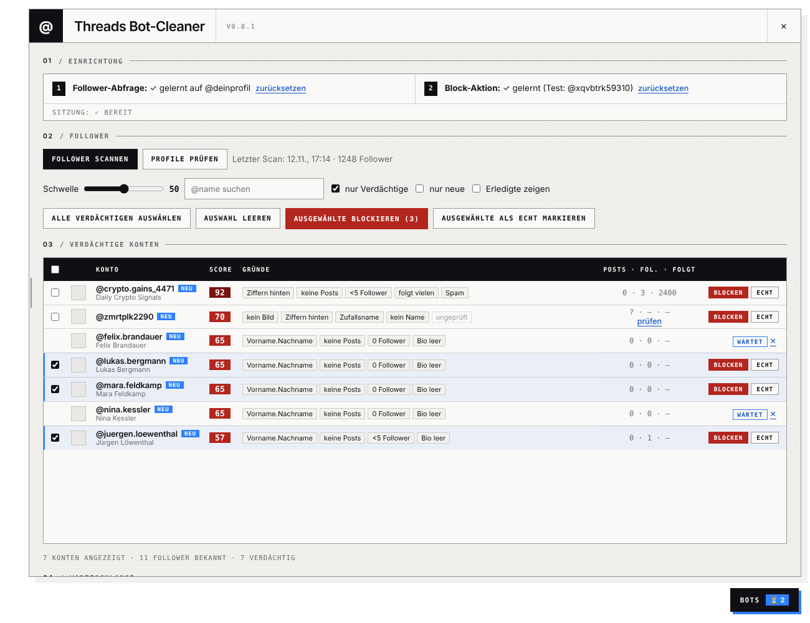

# Threads Bot-Cleaner

**Deutsch** · [English](#english)

Tampermonkey-Userscript, das Bot-Follower auf [Threads](https://www.threads.com) findet, bewertet und – nach deiner Auswahl – gedrosselt blockiert. Läuft komplett lokal in deinem Browser.

> [!WARNING]
> **Inoffizielles Tool, nicht mit Meta verbunden.** Es automatisiert Aktionen in deinem eigenen, eingeloggten Browser und verstößt damit streng genommen gegen Metas Nutzungsbedingungen. Zu viele Blocks in kurzer Zeit können zu vorübergehenden Aktionssperren führen. **Nutzung auf eigenes Risiko.**

## Installation

1. **[Tampermonkey](https://www.tampermonkey.net/) installieren.**
   In Chrome/Edge zusätzlich: Erweiterungen → Tampermonkey → Details → **„Nutzerskripts zulassen“** einschalten (bei älteren Versionen: Entwicklermodus aktivieren).
2. **Script installieren:** 
   Ein Klick öffnet direkt den Installationsdialog von Tampermonkey – nichts herunterladen oder kopieren. *(Zeigt der Browser nur Text, ist Tampermonkey noch nicht installiert oder aktiv.)*
3. **threads.com neu laden** → unten rechts erscheint der Button **BOTS**.

Updates kommen automatisch über Tampermonkey (sofort: Dashboard → „Nach Updates suchen“).

## Erster Durchlauf

| Schritt | Was du tust |
|---|---|
| **1. Follower-Abfrage lernen** | Auf deinem **eigenen** Profil auf „Follower“ tippen und in der Liste ein Stück nach unten scrollen. |
| **2. Follower scannen** | „Follower scannen“ klicken. Danach werden die Profile automatisch geprüft (Follower, Beiträge, Bio, Links). |
| **3. Block-Aktion lernen** | Einen **eindeutigen** Bot aus der Liste einmal ganz normal von Hand blockieren. |
| **4. Aufräumen** | Zeilen anklicken (**Shift + Klick** = ganzer Bereich) → „Ausgewählte blockieren“. Echte Konten mit „Echt“ dauerhaft ausnehmen. |

> [!TIP]
> **Beim ersten Mal klein anfangen:** erst 5–10 Konten blockieren und im Protokoll prüfen, ob alles klappt. Werte im gelben Bereich (knapp unter der Schwelle) vor dem Blocken kurz ansehen.

### Tempo & Limits

Standard: **20–40 s** zufällige Pause pro Block, **max. 100 pro Tag**. Sobald Meta bremst, pausiert das Script automatisch 24 h. Alles lässt sich unter „Einstellungen“ anpassen – erhöhe die Werte erst, wenn ein paar Tage ohne Sperre gelaufen sind. Die Warteschlange läuft, solange ein Threads-Tab offen ist, und setzt nach dem Neuladen fort.

## Bot-Score (0–100)

| Merkmal | Punkte |
|---|---|
| kein Profilbild | +30 |
| keine Beiträge | +25 |
| Ziffernfolge am Ende / am Anfang des Namens | +20 / +10 |
| 0 Follower / weniger als 5 | +20 / +12 |
| Spam-Begriffe (Crypto, Forex, „DM me“ …) | +20 |
| folgt sehr vielen, hat kaum Follower | +15 |
| privat · zusätzlich: privat, keine sichtbaren Beiträge, < 5 Follower | +10 · +15 |
| Zufallsname / kein Anzeigename | +12 / +8 |
| Schema „Vorname.Nachname“ | +10 |
| leere Bio ohne Links | +10 |

**Farben:** dunkelrot ≥ 80 · rot ≥ Schwelle (Standard 50) · gelb knapp darunter · grau unauffällig.
Verifizierte Konten und Konten, denen du selbst folgst, bekommen immer 0.

## Datenschutz

- Kein Server, keine Drittanbieter, keine externen Schriften oder Tracker.
- Sitzungs-Tokens werden **nie** gespeichert. Im `localStorage` von threads.com liegen nur Follower-Liste, Whitelist, Warteschlange, Einstellungen und Protokoll.
- „Diagnose-Info kopieren“ enthält keine Tokens und keine Konto-IDs.
- Löschen: Panel → Diagnose → „Alles zurücksetzen“.

## Bekannte Grenzen

- Getestet mit Chrome + Tampermonkey. Firefox, Edge und Violentmonkey sollten funktionieren, sind aber kaum erprobt.
- Das Script lernt die Anfragen der Threads-Weboberfläche. Ändert Meta etwas, reicht meist „zurücksetzen“ und die Lernschritte wiederholen.
- Die Erkennung ist eine Heuristik – stille Mitleser mit Klarnamen können knapp unter oder über der Schwelle landen.

## Probleme melden

[Issue anlegen](https://github.com/DieDaddelecke/threads-bot-cleaner/issues/new/choose) und die **Diagnose-Info** aus dem Panel einfügen (Panel → Diagnose → „Diagnose-Info kopieren“).

---

# English

A Tampermonkey userscript that finds bot followers on [Threads](https://www.threads.com), scores them and – after your review – blocks them at a throttled pace. Runs entirely locally in your browser. *(The interface is currently in German.)*

> [!WARNING]
> **Unofficial tool, not affiliated with Meta.** It automates actions in your own logged-in browser, which strictly speaking violates Meta's terms. Blocking too many accounts too fast can trigger temporary action blocks. **Use at your own risk.**

## Install

1. Install **[Tampermonkey](https://www.tampermonkey.net/)**. In Chrome/Edge also enable **“Allow user scripts”** in the extension details (or developer mode on older versions).
2.  – opens Tampermonkey's install dialog directly, no download needed.
3. Reload threads.com → a **BOTS** button appears bottom right. Updates arrive automatically.

## First run

1. **Learn the follower query:** on **your own** profile open “Followers” and scroll down a bit.
2. **Scan followers** („Follower scannen“). Profiles are then checked automatically.
3. **Learn the block action:** block one **obvious** bot manually, the normal way.
4. **Clean up:** click rows (**Shift + click** selects a range) → „Ausgewählte blockieren“ (block selected). Mark real accounts with „Echt“.

Start small – block 5–10 accounts first and check the log. Defaults: 20–40 s random delay, max. 100 blocks/day, automatic 24 h pause when Meta rate-limits. Adjust under „Einstellungen“ (settings).

## Privacy

No server, no third parties, no external fonts or trackers. Session tokens are never stored; only the follower list, whitelist, queue, settings and log are kept in threads.com's `localStorage`.

## Reporting issues

[Open an issue](https://github.com/DieDaddelecke/threads-bot-cleaner/issues/new/choose) and paste the diagnostics from the panel („Diagnose“ → „Diagnose-Info kopieren“).

## License

MIT – see [LICENSE](LICENSE). Changes: [CHANGELOG](CHANGELOG.md).
